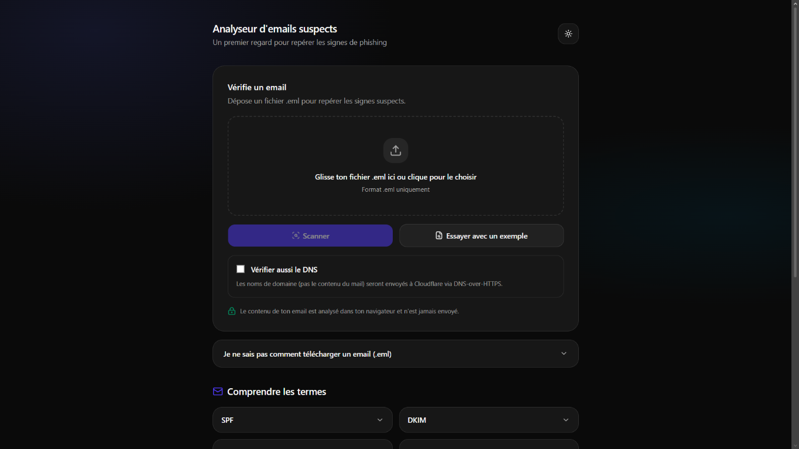
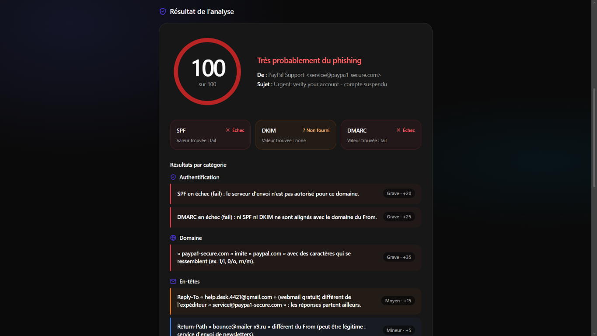
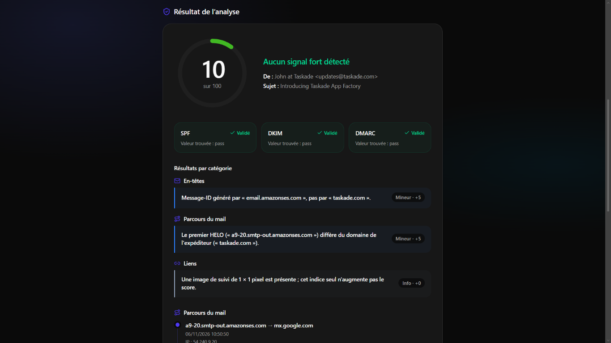
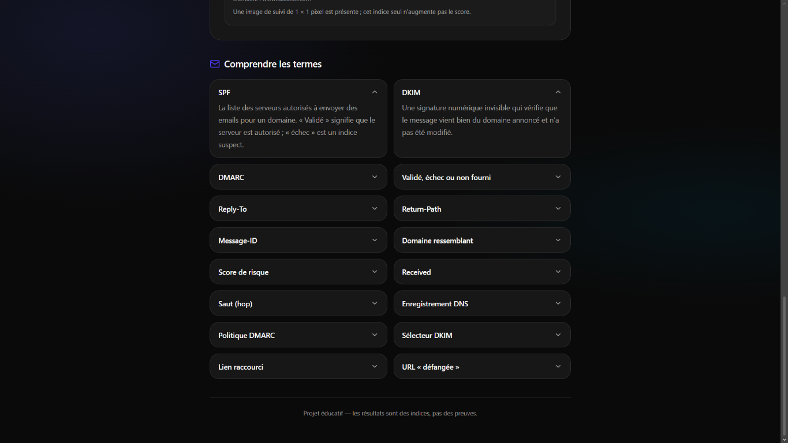
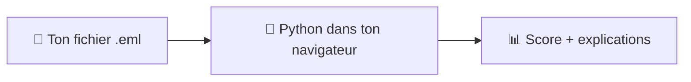

# 📧 Analyseur d'emails suspects

**Dépose un email, découvre en quelques secondes s'il ressemble à du phishing, et comprends pourquoi.**

  

<!-- Quand le site est en ligne, ajoute ici : **👉 [Essayer en ligne](https://TON-LIEN.vercel.app)** -->



## C'est quoi ?

Le **phishing** (hameçonnage), c'est un faux email qui se fait passer pour un service connu (banque, PayPal, livraison…) pour te voler des informations.

Chaque email contient des **en-têtes** : des informations techniques cachées (qui l'a vraiment envoyé, par quels serveurs il est passé…). Ce projet les lit et te dit, en français simple, **ce qui est normal et ce qui est suspect**.

> ⚠️ Le résultat est une **indication**, pas une preuve.

## 👀 Aperçu

**Un faux email PayPal : score 100/100**



*La jauge passe du vert au rouge. Chaque problème trouvé est expliqué avec sa gravité.*

**Une vraie newsletter légitime : score 10/100**



*Ici tout est validé. Les petites remarques (+5) sont normales pour les newsletters.*

**Un glossaire pour tout comprendre**



*Chaque terme technique est expliqué en une ou deux phrases.*

## 🔍 Ce que l'outil repère

| Ce qu'il vérifie | Pourquoi c'est suspect | Exemple |
|---|---|---|
| **L'identité de l'expéditeur** (SPF, DKIM, DMARC) | Si ces contrôles échouent, l'expéditeur est peut-être usurpé | `dmarc=fail` |
| **Un faux nom de domaine** | Les pirates imitent les vrais sites | `paypa1-secure.com` au lieu de `paypal.com` |
| **Une adresse de réponse différente** | Tes réponses partent chez le pirate | `Reply-To` en `@gmail.com` |
| **Un faux nom affiché** | Le nom dit « PayPal », l'adresse dit autre chose | « PayPal Support » `<x@autre-site.ru>` |
| **Le parcours du mail** | Dates incohérentes, adresses IP bizarres | Un message qui « arrive » avant d'être parti |
| **Les liens du message** | Le texte affiche un site, le lien mène ailleurs | Texte « paypal.com », lien vers un autre site |
| **Les enregistrements DNS** *(optionnel)* | Un vrai domaine a des règles d'envoi publiées | SPF ou DMARC absents |

### SPF, DKIM, DMARC : c'est quoi ?

- **SPF** : la liste des « facteurs » autorisés à distribuer le courrier d'un domaine.
- **DKIM** : un « sceau de cire » qui prouve que le message n'a pas été modifié.
- **DMARC** : la règle qui vérifie que l'adresse affichée correspond bien aux deux contrôles précédents.

## 📊 Comprendre le score

Chaque signal suspect ajoute des points. Le total va de 0 à 100.

| Score | Verdict | Exemple réel |
|---|---|---|
| **0 à 19** 🟢 | Aucun signal fort | Message légitime : **0** · Newsletter Taskade : **10** |
| **20 à 44** 🟠 | Email suspect | Lien trompeur : **35** |
| **45 à 100** 🔴 | Très probablement du phishing | Faux PayPal : **100** |

## ⚙️ Comment ça marche



1. Tu déposes un fichier `.eml` (un email enregistré).
2. Le moteur **Python** tourne **dans ton navigateur** grâce à **Pyodide** (Python compilé pour le web).
3. Il lit les en-têtes, le parcours et les liens, puis calcule le score.
4. Tu vois le résultat et les explications.

**Pas de serveur d'analyse** : ton email n'est jamais envoyé nulle part. Les liens du message ne sont **jamais ouverts**.

## 🚀 Essayer

### Version web (en local)

Il faut [Node.js](https://nodejs.org/). Dans le dossier du projet web :

```powershell
corepack pnpm install --frozen-lockfile
corepack pnpm dev
```

Ouvre [http://localhost:3000](http://localhost:3000), puis clique sur **Essayer avec un exemple**.

### Version terminal (Python)

Dans le dossier du paquet Python :

```powershell
python -m header_analyzer samples\phishing.eml
```

### Comment récupérer un fichier `.eml` ?

- **Gmail** : ouvre le mail → menu ⋮ → **Télécharger le message**.
- **Outlook** : **Fichier → Enregistrer sous** → format `.eml`.
- **Thunderbird** : clic droit sur le mail → **Enregistrer comme**.

> 💡 Ne clique sur aucun lien d'un mail suspect.

## 🔒 Confidentialité

| Situation | Ce qui sort de ton ordinateur |
|---|---|
| Analyse normale | **Rien.** Ton email reste dans le navigateur |
| Premier chargement | Le téléchargement de Pyodide (jsDelivr), pas ton email |
| Case « Vérifier aussi le DNS » cochée | Uniquement des **noms de domaine**, envoyés à Cloudflare. Jamais le contenu du mail |

La vérification DNS est **désactivée par défaut**. Aucun outil de statistiques n'est chargé.

## ✅ Tests réalisés

| Email testé | Attendu | Score |
|---|---|---:|
| Message légitime (exemple) | Aucun signal fort | 0 |
| Vraie newsletter (Taskade via Amazon SES) | Aucun signal fort | 10 |
| Lien trompeur (exemple) | Suspect | 35 |
| Faux PayPal (exemple) | Phishing | 100 |

Le projet contient **28 tests automatiques** qui vérifient aussi que des domaines légitimes (`groups.com`, `pineapple.com`, `ubs.com`…) ne sont **pas** pris pour du phishing.

```powershell
python -m unittest -v        # tests du moteur Python
corepack pnpm test:py        # vérifie que le Python tourne bien dans Pyodide
corepack pnpm build          # compile l'interface
```

## ⚠️ Limites

- SPF, DKIM et DMARC sont **lus** dans l'email : l'outil ne les recalcule pas.
- Les en-têtes d'un email peuvent être falsifiés ou incomplets.
- Les pièces jointes sont ignorées. Taille max : 25 Mo, 200 liens analysés.
- Un très gros email peut ralentir la page.

**Idées pour la suite** : exécuter l'analyse dans un Web Worker (pour ne pas figer la page), vérifier SPF en profondeur, ajouter plus de marques et de langues.

## 🗂️ Organisation du projet

Le dépôt réunit l'interface web, le moteur Python source de vérité et les captures :
```text
web/                                  # interface Next.js
├── app/                              # pages Next.js
├── components/email-analyzer.tsx     # page de scan et résultats
├── lib/analyzer-pyodide.ts           # exécute Python dans le navigateur
├── public/py/header_analyzer/        # copie navigateur du moteur Python
└── scripts/                          # synchronisation et smoke test
python/                               # source Python et CLI
├── header_analyzer/                  # moteur d'analyse
├── samples/                          # emails d'exemple
└── tests/                            # tests automatiques
docs/screenshots/                     # captures d'écran
```

Après une modification du Python, relance `corepack pnpm sync:py` pour mettre à jour la copie du site.

## 🎓 Ce que ce projet m'a appris

<!-- Réécris ces 4 points avec tes propres mots avant de présenter le projet. -->

- Comment un email prouve (ou non) qui l'a envoyé : SPF, DKIM, DMARC.
- Comment les pirates imitent des noms de domaine.
- Comment faire tourner du Python dans un navigateur, sans serveur.
- Comment tester un outil de détection pour éviter les fausses alertes.

## 📄 Licence

MIT. Projet éducatif.
